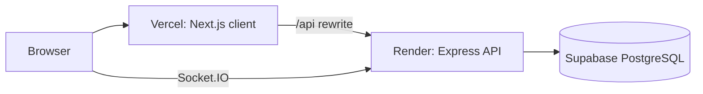

# IssueFlow

<p align="center">
  <a href="https://nextjs.org"></a>
  <a href="https://www.typescriptlang.org"></a>
  <a href="https://expressjs.com"></a>
  <a href="https://www.prisma.io"></a>
  <a href="https://socket.io"></a>
</p>

IssueFlow is a full-stack project and issue tracker for teams that want a clear view of their work. It combines a responsive Kanban board, a searchable list, project membership and permissions, threaded discussion, and live collaboration in one workspace.

## Live demo

- **Application:** [Deployment URL to be added](#)
- **Walkthrough video:** [Video URL to be added](#)

The demo uses free-tier hosting. If it is asleep, the service status banner explains the current state and offers a retry.

## Screenshots

> Screenshot placeholders: add captures of the landing page, dashboard, Kanban board, issue drawer, and mobile layout here.

## Features

- 🔐 Secure registration, login, and logout using an `httpOnly` authentication cookie.
- 🗂️ Projects with unique keys, member roles, invitations, and project settings.
- 🐛 Issues with priorities, types, assignees, search, filters, sorting, and pagination.
- 🧩 Drag-and-drop Kanban board with optimistic moves and touch-friendly status controls.
- 💬 Threaded issue comments with replies, editing, and soft deletion where replies exist.
- ⚡ Live issue, comment, membership, and project-presence updates using Socket.IO.
- 🛡️ Server-enforced membership and role authorization on project actions.
- 📱 Responsive interface, keyboard-accessible controls, theme toggle, and loading/error states.
- 💚 Live API/database status with recovery guidance for free-tier sleep and pause behavior.

## Architecture



REST is the source of truth for reads and mutations. Socket.IO broadcasts committed changes to authorized project rooms.

## Tech stack

| Area                      | Technologies                                                                 |
| ------------------------- | ---------------------------------------------------------------------------- |
| Client                    | Next.js App Router, React, TypeScript, Tailwind CSS, shadcn/ui, lucide-react |
| Forms and validation      | React Hook Form, Zod                                                         |
| API                       | Node.js, Express 5, TypeScript (ESM), Zod                                    |
| Database                  | PostgreSQL, Supabase, Prisma 6                                               |
| Authentication            | bcryptjs, JWT in an `httpOnly` cookie                                        |
| Realtime                  | Socket.IO                                                                    |
| Quality and observability | ESLint, Prettier, Pino, TypeScript                                           |
| Hosting target            | Vercel (client), Render (API), Supabase (database)                           |

## Roles and permissions

All project operations require membership unless the endpoint is explicitly public or operates on the signed-in user's own invitations. The server enforces these rules; hiding a UI control is not authorization.

| Action                                     |          OWNER          |          ADMIN          |        MEMBER        |
| ------------------------------------------ | :---------------------: | :---------------------: | :------------------: |
| View project, board, issues, and comments  |            ✓            |            ✓            |          ✓           |
| Create issues, move any issue, and comment |            ✓            |            ✓            |          ✓           |
| Edit project details                       |            ✓            |            ✓            |          —           |
| Delete project                             |            ✓            |            —            |          —           |
| Invite users and revoke invitations        |            ✓            |            ✓            |          —           |
| Change member roles                        |            ✓            |            —            |          —           |
| Remove another member                      |      Any non-owner      |      Members only       |          —           |
| Leave a project                            |   Owner cannot leave    |            ✓            |          ✓           |
| Edit an issue                              |            ✓            |            ✓            | Reporter or assignee |
| Delete an issue                            |            ✓            |            ✓            |       Reporter       |
| Edit a comment                             |         Author          |         Author          |        Author        |
| Delete a comment                           | Author or project admin | Author or project admin |        Author        |
| Accept or decline own invitation           |            —            |            —            | Invitation recipient |

Members may leave a project themselves, but cannot remove its owner. An ADMIN can remove a MEMBER, not another ADMIN or the OWNER.

## Repository layout

```text
.
├── client/                 # Next.js application
│   └── src/
│       ├── app/            # Marketing, auth, dashboard, and project routes
│       ├── components/     # Layout, common, project, issue, and UI components
│       ├── hooks/          # Auth, filters, board, and socket hooks
│       ├── lib/            # API client, environment, socket, and utilities
│       ├── providers/      # Auth, theme, and service status providers
│       └── types/          # API and domain types
├── server/                 # Express API
│   ├── prisma/             # Schema, migrations, and seed script
│   ├── scripts/            # Socket smoke test
│   ├── src/
│   │   ├── config/         # Environment, CORS, and cookie configuration
│   │   ├── lib/            # Prisma, JWT, errors, logging, and helpers
│   │   ├── middlewares/    # Auth, validation, rate limit, and error handling
│   │   ├── modules/        # MVC/service modules by domain
│   │   └── sockets/        # Socket.IO authentication, rooms, and presence
│   └── requests.http       # REST API examples and failure cases
├── .github/
└── .env.example            # Combined reference; create app-specific env files
```

## Local development

### Prerequisites

- Node.js compatible with the installed Next.js version (Node.js 20.9 or newer recommended).
- npm.
- A PostgreSQL database. Supabase is supported; use a pooled connection string for runtime and a direct connection string for migrations.

### 1. Clone and configure

```bash
git clone https://github.com/SaurabhPandey016/Project_management_app.git
cd Project_management_app
```

Create local environment files from the examples. In PowerShell:

```powershell
Copy-Item server\.env.example server\.env
Copy-Item client\.env.local.example client\.env.local
```

On macOS/Linux, use `cp server/.env.example server/.env` and `cp client/.env.local.example client/.env.local`.

Set `DATABASE_URL` to the pooled PostgreSQL connection string, `DIRECT_URL` to the direct connection string, and replace `JWT_SECRET` with a randomly generated secret of at least 32 characters. Keep real `.env` files out of version control.

### 2. Install, migrate, and seed

```bash
cd server
npm install
npm run prisma:generate
npm run prisma:deploy
npm run seed
```

The seed creates a sample `WEB` project and demo accounts, if they do not already exist. The demo owner is `demo@issueflow.dev` with password `Demo@12345`; use this only with a local/demo database and never as a production credential.

In another terminal:

```bash
cd client
npm install
```

### 3. Run both apps

Start the API from `server/`:

```bash
npm run dev
```

Start the client from `client/`:

```bash
npm run dev
```

Open [http://localhost:3000](http://localhost:3000). The API listens on port `10000` by default, and its health endpoint is [http://localhost:10000/api/health](http://localhost:10000/api/health).

## Environment variables

The root `.env.example` is a combined reference. The server reads `server/.env`; Next.js reads `client/.env.local`. Values in examples are placeholders, not credentials.

### Server

| Variable         | Required | Purpose                                                            |
| ---------------- | :------: | ------------------------------------------------------------------ |
| `NODE_ENV`       |    No    | `development`, `test`, or `production`; defaults to `development`. |
| `PORT`           |    No    | HTTP port; defaults to `10000`.                                    |
| `DATABASE_URL`   |   Yes    | Pooled PostgreSQL URL used by the running API.                     |
| `DIRECT_URL`     |   Yes    | Direct PostgreSQL URL used by Prisma migrations.                   |
| `JWT_SECRET`     |   Yes    | Random signing secret, at least 32 characters.                     |
| `JWT_EXPIRES_IN` |    No    | JWT lifetime such as `7d`; defaults to `7d`.                       |
| `CLIENT_URL`     |   Yes    | Exact allowed client origin, e.g. `http://localhost:3000`.         |

### Client

| Variable                     |        Required         | Purpose                                                                       |
| ---------------------------- | :---------------------: | ----------------------------------------------------------------------------- |
| `NEXT_PUBLIC_API_URL`        |           No            | API base used for direct health checks; defaults to `http://localhost:10000`. |
| `NEXT_PUBLIC_SOCKET_URL`     |           No            | Socket.IO server URL; defaults to `http://localhost:10000`.                   |
| `BACKEND_URL`                | Yes for deployed client | Server-side Next.js rewrite destination, e.g. `http://localhost:10000`.       |
| `NEXT_PUBLIC_DEMO_VIDEO_URL` |           No            | Optional walkthrough link; empty means the video is not configured.           |
| `NEXT_PUBLIC_LINKEDIN_URL`   |           No            | Contact link shown in the UI.                                                 |
| `NEXT_PUBLIC_GITHUB_URL`     |           No            | Contact link shown in the UI.                                                 |
| `NEXT_PUBLIC_CONTACT_EMAIL`  |           No            | Contact email shown in the UI.                                                |

`NEXT_PUBLIC_*` variables are embedded at build time. Change them in the hosting configuration and rebuild/redeploy the client to publish updates.

## API overview

All API routes are under `/api`. Except for health, endpoints require the `issueflow_token` cookie unless a row is marked public. Project routes also require project membership; action-specific role checks apply.

| Method                   | Path                                            | Description                                               | Auth                                 |
| ------------------------ | ----------------------------------------------- | --------------------------------------------------------- | ------------------------------------ |
| `GET`                    | `/health`                                       | API and database health (`200` even when the DB is down). | Public                               |
| `POST`                   | `/auth/register`                                | Register and set the auth cookie.                         | Public                               |
| `POST`                   | `/auth/login`                                   | Sign in and set the auth cookie.                          | Public                               |
| `POST`                   | `/auth/logout`                                  | Clear the auth cookie.                                    | Cookie if present                    |
| `GET`                    | `/auth/me`                                      | Get the current user.                                     | Required                             |
| `GET`                    | `/auth/socket-token`                            | Issue a short-lived Socket.IO token.                      | Required                             |
| `GET`, `POST`            | `/projects`                                     | List or create projects.                                  | Required                             |
| `GET`, `PATCH`, `DELETE` | `/projects/:projectId`                          | Read, update, or delete project settings.                 | Member; role-gated                   |
| `POST`, `GET`            | `/projects/:projectId/invitations`              | Create or list project invitations.                       | ADMIN+                               |
| `DELETE`                 | `/projects/:projectId/invitations/:id`          | Revoke an invitation.                                     | ADMIN+                               |
| `GET`                    | `/invitations/mine`                             | List invitations for the signed-in user.                  | Required                             |
| `POST`                   | `/invitations/:id/accept` or `/decline`         | Respond to an invitation.                                 | Invitation recipient                 |
| `PATCH`, `DELETE`        | `/projects/:projectId/members/:userId`          | Update a role or remove/leave a project.                  | Member; role-gated                   |
| `GET`, `POST`            | `/projects/:projectId/issues`                   | Search/filter/paginate issues or create one.              | Project member                       |
| `GET`                    | `/projects/:projectId/board`                    | Get filtered issues grouped by status.                    | Project member                       |
| `GET`, `PATCH`, `DELETE` | `/projects/:projectId/issues/:issueId`          | Read, update, or delete an issue.                         | Project member; role/ownership-gated |
| `PATCH`                  | `/projects/:projectId/issues/:issueId/move`     | Move an issue and persist its column order.               | Project member                       |
| `GET`, `POST`            | `/projects/:projectId/issues/:issueId/comments` | List threaded comments or add a comment/reply.            | Project member                       |
| `PATCH`, `DELETE`        | `/projects/:projectId/comments/:commentId`      | Edit or delete a comment.                                 | Project member; author/admin-gated   |

Issue-list query parameters include `q`, `status`, `priority`, `type`, `assigneeId`, `sortBy`, `order`, `page`, and `limit` (maximum `100`). The board accepts the shared filter parameters but groups results by status. See [`server/README.md`](server/README.md) and [`server/requests.http`](server/requests.http) for examples.

### API response convention

Success responses use `{ "success": true, "data": ... }` and may include a `message`. Errors use `{ "success": false, "error": { "code": "...", "message": "...", "details": ... } }`. Validation errors are `400`; authorization errors are `403`; missing resources are `404`; conflicts are `409`; rate limits are `429`; unexpected errors are `500`.

## Realtime events

Clients authenticate the Socket.IO connection with the short-lived socket token, then join project rooms as authorized members. Events are broadcasts of REST changes; the client ignores its own event echo.

| Event             | Payload summary                            |
| ----------------- | ------------------------------------------ |
| `issue:created`   | Created issue and `actorId`                |
| `issue:updated`   | Updated issue and `actorId`                |
| `issue:moved`     | Moved issue and `actorId`                  |
| `issue:deleted`   | Deleted issue and `actorId`                |
| `comment:created` | Created comment and `actorId`              |
| `comment:updated` | Updated comment and `actorId`              |
| `comment:deleted` | Deleted/soft-deleted comment and `actorId` |
| `member:joined`   | Added member and `actorId`                 |
| `member:removed`  | Removed member and `actorId`               |
| `presence:update` | Current users in a project room            |

## Free-tier note

Free hosting plans may sleep after inactivity, and free database projects may pause. The client status banner distinguishes the API waking up from an unavailable database, reports live status, and provides retry/contact options. The walkthrough link is optional: configure `NEXT_PUBLIC_DEMO_VIDEO_URL` when a video is available; otherwise the UI indicates that the video is coming soon.

## Deployment summary

- **Database:** create a PostgreSQL database and configure pooled `DATABASE_URL` plus direct `DIRECT_URL`.
- **API (Render):** create a Node web service rooted at `server/`; build with `npm install && npm run prisma:generate && npm run build`, then start with `npm run start`. Configure the server environment and run `npm run prisma:deploy` as the deployment migration step.
- **Client (Vercel):** import the repository with `client/` as the project root, configure the client environment (including `BACKEND_URL` to the API origin), then build with `npm run build`.
- Set the API `CLIENT_URL` to the deployed client origin. Configure the client’s public API/socket URLs to the API origin as well.

These are deployment instructions, not live deployment links. No production URLs are published here yet.

## Contact

- [LinkedIn](https://www.linkedin.com/in/saurabhpandey-/)
- [GitHub](https://github.com/SaurabhPandey016)
- [Email](mailto:developersaurabh001@gmail.com)

**Made with ❤️ by Saurabh Pandey**
